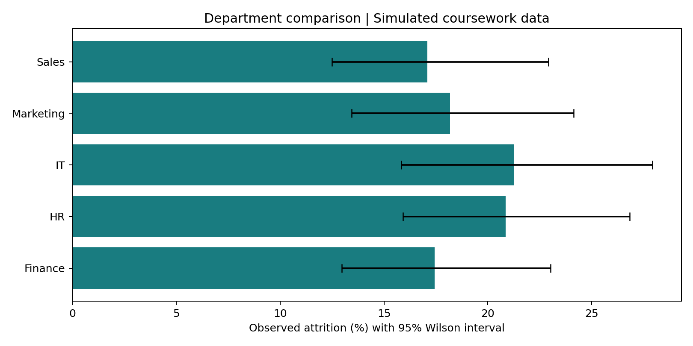

# Employee Attrition Insights

## Project overview / 项目概述

分组探索、离职率、交互对比 / Group exploration, attrition rates, interactive comparisons。

**Interactive portfolio:** [Employee attrition insights](https://milanchen0307-cmyk.github.io/employee-attrition-insights/) — public, no login required.
**Source code:** public repository with notebooks, analysis scripts and dashboard source.

员工流失探索：按部门、加班及工作生活平衡分组，结合样本量与不确定性提出待验证假设。

**Question:** Which aggregate patterns deserve investigation, and how do group sizes change our confidence in the apparent differences?

The original project was described as an IBM/HR analysis, but the available file is a 1,000-row simulated coursework dataset. This portfolio does **not** represent it as actual IBM employee records or as the canonical IBM dataset.

## 阅读方式 / Start here

This is a coursework project curated into a reproducible portfolio. The original analytical approach is retained; the standalone presentation and validation scripts are a later portfolio refinement.

Open **[the interactive demo](https://milanchen0307-cmyk.github.io/employee-attrition-insights/)** or download the repository and open `docs/index.html` directly. The hosted demo is public. Explore the code, notebooks and aggregate results in this repository. No API key is needed to open the local HTML version.

## Repository map

- `docs/`: standalone interactive evidence page and its aggregate data.
- `src/`: reproducible portfolio analysis/export and rendering scripts.
- `reports/`: machine-readable aggregate evidence and figures.
- `notebooks/`: original coursework source, cleared of outputs and execution state.
- `data/README.md`: input schema and data access notes.


## Evidence and interaction

- 1,000 simulated records; 189 attrition cases; overall observed rate 18.9%.
- Filter department and overtime; view work–life-balance group rates and denominators together.
- Department summary includes 95% Wilson intervals. These quantify binomial sampling uncertainty, not bias, causality or real-world transportability.
- Original interaction notebook explores overtime × work–life balance, income × job level, promotion × tenure, and other relationships. Its fitted probabilities are in-sample exploratory outputs, not validated individual predictions.



## Decision relevance and boundaries

Use aggregate differences to design follow-up questions and better data collection. Do not infer that overtime or any other variable caused attrition, and do not use this dashboard to screen or rank employees. Gender, age and individual identifiers are not included in the published interactive dataset. Small groups should not drive conclusions.

## Reproduce locally

```bash
python -m venv .venv
# Activate .venv using your platform's standard command.
python -m pip install -r requirements.txt
python src/analyze.py --data /path/to/employee_attrition_dataset.csv
python src/render_site.py
```

Use an authorized local copy of the original dataset. Raw data is not required to inspect the checked-in aggregate results or to open the interactive demo. Original datasets are not silently replaced with synthetic data.

## Data and attribution

This is a team coursework project. Existing authorship in source material is retained. Source code cleanup and presentation do not imply sole authorship of the original work. No third-party data license is granted by this repository; source datasets and third-party materials retain their original terms. The original source URL/license still needs to be documented where noted in `data/README.md`.
